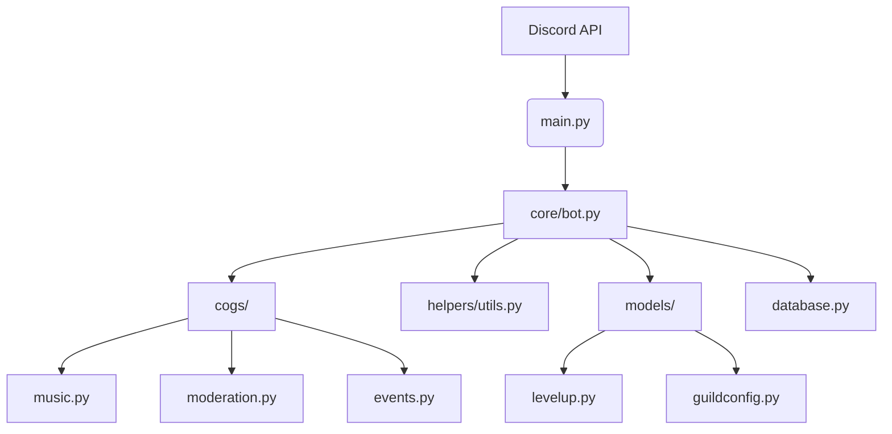

```py
mybot/
│
├── main.py               
├── config.py              
├── utils/              
│   └── (helper files)
|
├── cogs/                   
│   ├── birthdays/ (birthday files)
│   ├── moderation/ (moderation files)
│   ├── guildsettings/ (guildsettings files)
│   ├── invitetracting/ (invitetracking files)
│   └── userstats/ (userstats files)          
│
├── data/                  
│   └── botdata.db              
│
├──database/
│   └── connect, create, update files
|
├──models/
|   └──birthdays.py
|   └──guildconfig.py
|   └──moderation.py
|   └──invitetracker.py
|   └──levelup.py

```


Creating an architecture diagram is a great idea for maintaining clarity as your project grows. Here's a step-by-step guide to help you create a **clean, modular architecture diagram** for your Discord bot project.

---

### ✅ **1. Decide the Purpose and Audience**

Are you making this for:

* Yourself (to maintain the code)?
* Contributors (to onboard them)?
* Stakeholders (to explain how it works)?

For a **developer-focused** diagram, include internal components like cogs, models, etc.

---

### ✅ **2. Choose a Tool**

Use tools like:

* **Draw\.io / Diagrams.net** (free, powerful)
* **Lucidchart** (clean UI, free tier)
* **Excalidraw** (hand-drawn look, fast)
* **Mermaid.js** (code-based, e.g., for Markdown docs or GitHub README)

---

### ✅ **3. Define Main Layers of Your Bot Architecture**

You can split your architecture into logical **layers or components**:

#### High-Level Architecture Diagram (Top Layer)

```
        ┌──────────────┐
        │   Discord    │
        └─────┬────────┘
              │
        ┌─────▼─────┐
        │   main.py │ Entry Point
        └─────┬─────┘
              │
   ┌──────────▼─────────┐
   │   Custom Bot Class │ (core/bot.py)
   └──────────┬─────────┘
              │
 ┌────────────▼─────────────┐
 │     Cogs (Features)      │
 │ music.py, moderation.py  │
 │ fun.py, events.py, etc.  │
 └────────────┬─────────────┘
              │
 ┌────────────▼──────────────┐
 │     Helpers / Utils       │
 └────────────┬──────────────┘
              │
 ┌────────────▼──────────────┐
 │     Models (LevelUp, etc) │
 └────────────┬──────────────┘
              │
 ┌────────────▼──────────────┐
 │     Database Access       │ (database.py, data/)
 └───────────────────────────┘
```

---

### ✅ **4. Optional: Include Frontend/Backend Separation**

If you're also building a **frontend/backend** setup (like for dashboards or web panels), extend the diagram:

```
              User
                │
     ┌──────────▼─────────┐
     │     Frontend       │ (React, HTML, etc.)
     └──────────┬─────────┘
                │
     ┌──────────▼─────────┐
     │     Backend API     │ (FastAPI / Flask)
     └──────────┬─────────┘
                │
     ┌──────────▼─────────┐
     │    Shared Models    │
     └──────────┬─────────┘
                │
     ┌──────────▼─────────┐
     │  Database / Storage │
     └────────────────────┘
```

---

### ✅ **5. Create the Diagram**

If you use **Draw\.io**, here’s a quick layout idea:

* Use **rectangles** for modules (label with paths like `cogs/music.py`)
* Use **arrows** for direction of dependencies or calls
* Use **color** to group: e.g., blue for core, green for models, orange for frontend

---

### ✅ **6. Keep It Maintainable**

As your project grows:

* Keep the diagram in `/docs/architecture.png` or `.drawio`
* Update it when adding major features
* Include it in the README or internal wiki

---

### ✅ Bonus: Mermaid Example (for Markdown)



---

Would you like a ready-made **editable diagram (Draw\.io or Mermaid)** of your current structure? I can generate one for you.
